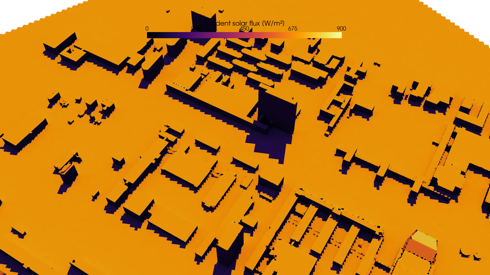
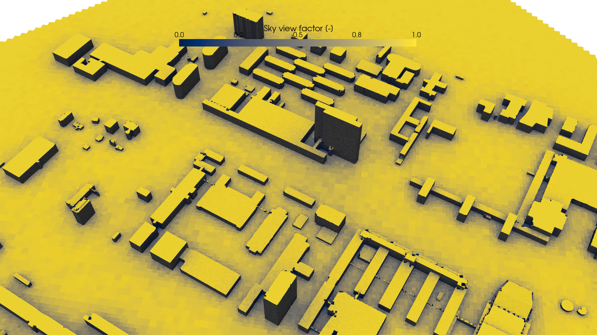

# solar-raycast-openfoam



Per-face **solar irradiance** on the wall patches of an OpenFOAM mesh (ground and buildings), by ray
casting: direct sun with shadows, diffuse sky through the sky view factor, and two diffuse
inter-reflection bounces. The result goes into a buoyant OpenFOAM run as a **sol-air temperature
boundary condition**: a per-face surface energy balance, so hot surfaces lose heat and stay bounded.

For ground albedo, sensible fraction and roughness per face from ESA WorldCover, see
[z0-worldcover-openfoam](https://github.com/Jupihawx/z0-worldcover-openfoam). This tool also runs without
it, with uniform values per patch.

- OpenFOAM **v2412** (openfoam.com / ESI) for the boundary conditions and the example case. The Foundation
  version (openfoam.org) differs (BC names, `atmosphericModels`). The ray casting itself only reads the
  mesh. The example was also run on v2606.
- Python 3.10–3.12 (open3d has no wheels for newer Python yet, see [Install](#install)).
- Status: the tool runs and the sol-air BC is stable (300+ iterations on 34 M cells, and the example).
  It is **not a validated microclimate model**: no longwave exchange between surfaces, no thermal mass,
  one linear loss coefficient. Treat results as a physically plausible demonstration.

| File | What it does |
|---|---|
| `solar_illumination.py` | Ray casting (Open3D/Embree), writes `illumination.vtp` and the per-face `Tsolair` / `z0` lists |
| `example/` | TU Delft campus (OSM buildings, STL included): ray casting + optional `buoyantSimpleFoam` |
| `docs/pitfalls.md` | What went wrong on the way (wall functions, pressure BC, z0 decomposition, ...) |

---

## Method

1. Read the wall patches with PyVista (`vtkOpenFOAMReader`); geometry only, `0/` is never parsed.
2. Build an Embree scene (Open3D) from the triangulated wall faces.
3. **Direct:** one shadow ray per face toward the sun: `qDirect = DNI·cos θ` if not shadowed.
4. **Hemisphere:** N cosine-weighted rays per face, cast **once**. Each ray records sky, below-horizon or
   the face it hit. Sky view factor → `qSky = DHI·SVF`.
5. **Bounces 1 and 2:** table lookups on the stored hits (`albedo·E` of the hit face). No new rays;
   equivalent to two Jacobi iterations of Monte-Carlo radiosity.
6. `qIncident = qDirect + qSky + qBounce1 + qBounce2`, `qAbsorbed = (1 − albedo)·qIncident`,
   `qSensible = sensibleFraction·qAbsorbed` (the part that heats the air; the rest goes to evaporation
   and storage).

Built-in check: open flat ground should read `qIncident ≈ DNI·sin(elevation) + DHI`, printed as
"reference GHI".



## Conventions

| | |
|---|---|
| Mesh axes | x = East, y = North, z = up, metres, ground at z = 0 |
| Sun azimuth | compass: 0 = North = +y, 90 = East = +x. Elevation above the horizon, degrees |
| DNI / DHI | direct normal / diffuse horizontal irradiance, W/m² |
| Normals | OpenFOAM boundary normals point out of the fluid; the tool flips them (`--no-flip-normals`) |
| Face order | per-face lists are in **polyMesh face order** of each patch |

## Install

```bash
curl -LsSf https://astral.sh/uv/install.sh | sh          # uv: fetches a supported Python itself
~/.local/bin/uv venv --python 3.12 ~/venv-solar
~/.local/bin/uv pip install --python ~/venv-solar -r requirements.txt
sudo apt install libusb-1.0-0                             # Ubuntu/WSL: open3d import fails without it
~/venv-solar/bin/python solar_illumination.py --help
```

Why uv: open3d lags new Python releases (tested: open3d 0.20.0 on Python 3.12; no wheels for 3.13/3.14
at the time of writing), and Ubuntu's system Python blocks `pip` (PEP 668). Any venv with Python ≤ 3.12
works the same way.

## Quickstart

```bash
cd <case>                               # meshed: constant/polyMesh or <time>/polyMesh
python solar_illumination.py . --patches Terrain Buildings \
    --sun-azimuth 235.3 --sun-elevation 51.5 --dni 750 --dhi 130 \
    --albedo Terrain=0.20 --sensible-fraction Terrain=0.7 \
    --albedo Buildings=0.30 --sensible-fraction Buildings=1.0 \
    --sol-air 10 298.15 --samples 256
```

Run with `--samples 64` first to check the setup, then 256–512. Open
`solarIllumination/illumination.vtp` in ParaView: shadows must fall away from the sun, and open ground
must read the reference GHI.

### Ground materials from the z0 repository (`--material-map`)

`make_z0.py` of [z0-worldcover-openfoam](https://github.com/Jupihawx/z0-worldcover-openfoam) writes, next to
z0, `albedo` and `sensibleFraction` per point in `constant/boundaryData/Terrain/0/` (WorldCover class
table). Pass the folder:

```bash
python solar_illumination.py . ... --material-map Terrain=constant/boundaryData/Terrain
```

Each ground face takes the nearest map point. If the folder also holds `0/z0`, the tool writes it as a
per-face list `solarIllumination/T_solar/Terrain.z0`, in the same face order, for the wall functions.
Patches without a map keep `--albedo` / `--sensible-fraction`. Without any map the tool uses uniform
values (default albedo 0.2, sensible fraction 1.0).

## Outputs (`<case>/solarIllumination/`)

| Output | Use |
|---|---|
| `illumination.vtp` | Wall surface with `qDirect, qSky, qBounce1, qBounce2, qIncident, qAbsorbed, qSensible, skyViewFactor, sunlit, albedo, sensibleFraction, patchId` |
| `T_solar/<patch>.Tsolair` | Sol-air temperature per face (with `--sol-air`): `refValue` of the T boundary condition |
| `T_solar/<patch>.z0` | z0 per face (with a `--material-map` holding z0) for `atmNutkWallFunction` / `atmEpsilonWallFunction` |

Both are bare lists (`nonuniform List<scalar> N (...)`) for
`#include "$FOAM_CASE/solarIllumination/T_solar/<patch>.<x>"`. They belong to one mesh: rerun after remeshing.

## The sol-air boundary condition

Surface energy balance per face, linearised:

    q_air = qSensible − h·(Tw − Tref)

`h` (W/m²K) lumps longwave loss and storage (10 W/m²K ≈ 7 longwave + 3 storage); `Tref` is a fixed
reference (2 m air temperature), not the local air. As a mixed BC with `refGradient = 0`:

    refValue      = Tsolair = Tref + qSensible/h          (per face, T_solar/<patch>.Tsolair)
    valueFraction = h / (h + kappaEff·deltaCoeffs)        (updated every iteration)
    kappaEff      = Cp·(mu/Pr + alphat)

The wall temperature then always lies between the cell temperature and `Tsolair`: it cannot run away.

```
// 0/T (as in example/case/0/T)
solAir
{
    type            codedMixed;
    refGradient     uniform 0;
    valueFraction   uniform 0;
    value           $internalField;
    name            solAirMixed;
    code
    #{
        const scalar h        = 10.0;            // = H of --sol-air
        const scalar Cp       = 1005.0;          // as in thermophysicalProperties
        const scalar alphaLam = 1.86e-5/0.71;    // mu/Pr
        const scalarField& alphat =
            patch().lookupPatchField<volScalarField, scalar>("alphat");
        const scalarField kappaEff(Cp*(alphaLam + max(alphat, scalar(0))));
        this->refGrad() = 0.0;
        this->valueFraction() = h/(h + kappaEff*patch().deltaCoeffs());
    #};
}
boundaryField
{
    Terrain   { $solAir; refValue #include "$FOAM_CASE/solarIllumination/T_solar/Terrain.Tsolair"; }
    Buildings { $solAir; refValue #include "$FOAM_CASE/solarIllumination/T_solar/Buildings.Tsolair"; }
}
```

- `h` in `0/T` **must equal** `H` of `--sol-air H TAIR`, and `TAIR` should equal the inflow `Tair`.
- Needs a compressible thermo solver (`buoyantSimpleFoam`, `buoyantPimpleFoam`) that registers `alphat`.
  Boussinesq behaviour comes from `equationOfState Boussinesq` in `thermophysicalProperties`.
- `decomposePar` splits `refValue` correctly. The z0 lists of the atm wall functions it does **not**
  split in v2412: run `tools/decompose_z0.py` of the z0 repository with
  `--list "solarIllumination/T_solar/{patch}.z0"` after `decomposePar`.
- An exact T⁴ longwave version is possible but not implemented.

## Options

| Option | Default | Meaning |
|---|---|---|
| `--patches` | all `type wall` patches | Patches to illuminate |
| `--sun-azimuth`, `--sun-elevation` | 135 / 35 | Compass azimuth, elevation, degrees |
| `--sun-dir X Y Z` | | Vector toward the sun (overrides azimuth/elevation) |
| `--dni`, `--dhi` | 800 / 120 | W/m² |
| `--albedo P=V` | `--default-albedo` 0.2 | Per patch, repeatable |
| `--sensible-fraction P=V` | `--default-sensible-fraction` 1.0 | Per patch, repeatable |
| `--material-map P=DIR` | | Per-face albedo, sensible fraction (and z0) from a boundaryData folder |
| `--sol-air H TAIR` | | Write the `Tsolair` lists |
| `--samples` | 256 | Hemisphere rays per face |
| `--bounces` | 2 | 0, 1 or 2 |
| `--time` | latest `<time>/polyMesh`, else `constant` | Which mesh to read |
| `--out` | `<case>/solarIllumination` | Output folder |

## RAM and runtime

The hit table is `faces × samples × 4 bytes`:

| Wall faces | Samples | Hit table | Runtime (measured) |
|---|---|---|---|
| 181 k | 256 | 0.19 GB | ~5 s |
| 5.5 M | 256 | 5.6 GB | ~2 min |
| 5.5 M | 512 | 11 GB | ~4 min |
| 5.5 M | 1024 | 22 GB | ~8 min |
| 9.3 M | 256 | ~10 GB | |
| 89.5 k (example) | 256 | 92 MB | ~3 s |

512 samples is a good balance on multi-million-face meshes; 1024 only with ≥ 32 GB free.

## Example: TU Delft campus

`example/` takes ~1.3 km of TU Delft buildings from OpenStreetMap (STL included), meshes a box aligned with the wind,
runs the ray casting and, optionally, `buoyantSimpleFoam` with the sol-air BC. See
[`example/README.md`](example/README.md). The z0 repository uses the same site.

## Data and attribution

- **OpenStreetMap** (example geometry): © OpenStreetMap contributors, ODbL 1.0,
  <https://www.openstreetmap.org/copyright>. Generated at run time, not stored here.
- **ESA WorldCover 2021 v200** (through the z0 repository, optional): CC BY 4.0, Zanaga et al. (2022),
  doi:[10.5281/zenodo.7254221](https://doi.org/10.5281/zenodo.7254221).
- Sun position and irradiance in the example are illustrative values. For real days, ERA5 radiation:
  Hersbach et al. (2023), ERA5 hourly data on single levels, Copernicus Climate Change Service (C3S)
  Climate Data Store, doi:10.24381/cds.adbb2d47.

## Licence and citation

Code: MIT, see [LICENSE](LICENSE). To cite, see [CITATION.cff](CITATION.cff).
